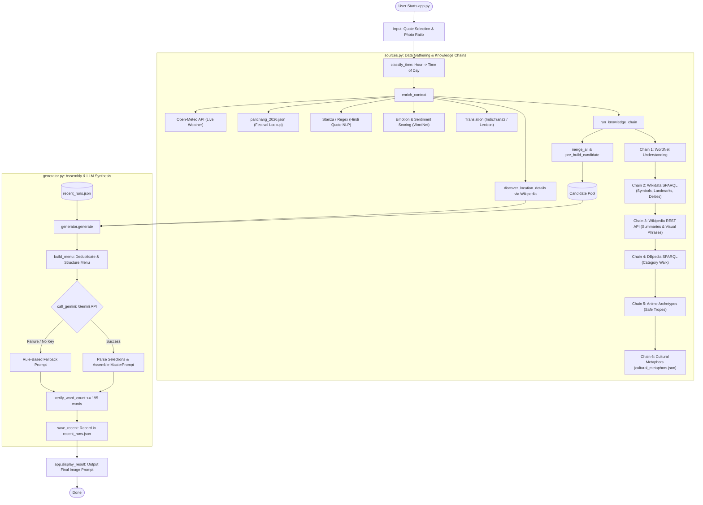

# Vibzee Codebase Architecture & Technical Documentation

This document provides an end-to-end breakdown of the **Vibzee** project: its purpose, execution flow, function-by-function documentation, flowchart, and a breakdown of static vs. dynamic/API elements.

---

## 1. System Overview

**Vibzee** is an automated pipeline that takes a Hindi quote (or selects one randomly), enriches it with real-time contextual world data (weather, festival, time of day, knowledge graphs, and cultural metaphors), and synthesizes a structured, highly detailed image generation prompt (targeted for models like FLUX Schnell or DALL-E 3).

### Key Files in Workspace
- **[app.py](file:///Users/jiyajain/Desktop/Internship/vibzee/app.py)**: CLI entry point and top-level orchestrator of the pipeline.
- **[specs.py](file:///Users/jiyajain/Desktop/Internship/vibzee/specs.py)**: Data models (Pydantic), design constants, layout profiles, domain styles, emotion mappings, SPARQL query templates, and system prompt.
- **[sources.py](file:///Users/jiyajain/Desktop/Internship/vibzee/sources.py)**: World data gathering engine — NLP, weather API, panchang lookup, knowledge graph queries (Wikidata, Wikipedia, DBpedia, AniList), cultural metaphor extraction, and candidate assembly.
- **[generator.py](file:///Users/jiyajain/Desktop/Internship/vibzee/generator.py)**: Prompt synthesis engine — formats candidate menu, calls Gemini LLM (with fallback logic), enforces word count, and handles run-history recency deduplication.
- **[panchang_2026.json](file:///Users/jiyajain/Desktop/Internship/vibzee/panchang_2026.json)**: Hindu calendar mapping dates to festival information.
- **`data/cultural_metaphors.json`**: Curated Indian cultural symbols mapped to philosophical concepts.
- **`data/recent_runs.json`**: History of recent runs to avoid repetitive prompts.

---

## 2. Execution Flow (What Executes & Calls What)

```
[User runs app.py]
      │
      ▼
1. CLI collects quote choice and photo aspect ratio (or defaults to random quote + 1:1)
      │
      ▼
2. app.run(...)
      │
      ├─► classify_time(hour) ──► Computes time period ("dawn", "morning", etc.)
      │
      ├─► Step 1: sources.enrich_context(...)
      │         ├─► sources.get_weather(...) ──► Calls Open-Meteo API
      │         ├─► sources.get_festival(...) ──► Reads panchang_2026.json
      │         ├─► sources.analyze_quote(...) ──► Stanza Hindi NLP / regex tokenizer
      │         ├─► sources.detect_emotion(...) ──► WordNet synonym scoring & sentiment
      │         └─► sources.translate_hi_to_en(...) ──► IndicTrans2 / fallback lexicon
      │
      ├─► Step 2: sources.run_knowledge_chain(...)
      │         ├─► chain_1_word_understanding(...) ──► WordNet hypernyms / abstract check
      │         ├─► chain_2_wikidata(...) ──► Wikidata SPARQL queries
      │         ├─► chain_3_wikipedia(...) ──► Wikipedia REST API summary & categories
      │         ├─► chain_4_dbpedia(...) ──► DBpedia category graph traversal
      │         ├─► chain_5_fictional(...) ──► Safe anime archetypes
      │         ├─► chain_6_cultural(...) ──► Indian cultural metaphors
      │         ├─► discover_location_features(...) ──► Wikidata landmarks for location
      │         ├─► merge_all(...) ──► Deduplicate and assign domains/flags
      │         └─► pre_build_candidate(...) ──► Formats scene & subject text
      │
      ├─► Step 3: sources.discover_location_details(...)
      │         └─► Wikipedia summary parsing for visual adjectives and nouns
      │
      ├─► Step 4: generator.generate(...)
      │         ├─► generator.load_recent() ──► Reads data/recent_runs.json
      │         ├─► generator.build_menu(...) ──► Filters recency & constructs LLM prompt menu
      │         ├─► generator.call_gemini(...) ──► Invokes Google Gemini API
      │         │     └─► [On Exception] generator.fallback(...) ──► Rule-based prompt assembly
      │         ├─► generator.build_master_prompt(...) ──► Converts Gemini JSON into MasterPrompt
      │         ├─► generator.verify_word_count(...) ──► Ensures prompt <= 195 words
      │         └─► generator.save_recent(...) ──► Writes run metadata to data/recent_runs.json
      │
      ▼
3. app.display_result(...) ──► Outputs final FLUX/DALL-E prompt, layout, domain, and reasoning
```

---

## 3. Detailed Function-by-Function Breakdown

### A. [app.py](file:///Users/jiyajain/Desktop/Internship/vibzee/app.py)

1. `classify_time(hour: int) -> str`
   - **Purpose**: Maps a 24-hour integer (`0-23`) to natural daylight phases (`pre-dawn`, `dawn`, `morning`, `late-morning`, `afternoon`, `evening`, `dusk`, `night`).
2. `display_result(prompt: MasterPrompt)`
   - **Purpose**: Prints the final synthesized prompt, layout profile, visual domain, photo approach, metaphor used, word count, and Gemini's reasoning to stdout.
3. `run(quote: str = None, photo_ratio: str = "1:1", location_key: str = "varanasi") -> MasterPrompt`
   - **Purpose**: The main pipeline entry point. Selects quote and location, invokes `sources.enrich_context`, `sources.run_knowledge_chain`, and `sources.discover_location_details`, passes the context to `generator.generate`, displays the result, and returns the `MasterPrompt`.

---

### B. [sources.py](file:///Users/jiyajain/Desktop/Internship/vibzee/sources.py)

#### Model Lazy Loaders & Network Helpers
1. `_get_stanza()`: Lazy-loads Stanza Hindi pipeline (`tokenize,pos,lemma,depparse`). Returns `None` if not installed.
2. `_get_translator()`: Lazy-loads IndicTrans2 toolkit.
3. `_get_wordnet()`: Lazy-loads NLTK WordNet corpus.
4. `_get_stanza_en()`: Lazy-loads English Stanza pipeline for extracting visual descriptors from Wikipedia text.
5. `_session() -> requests.Session`: Creates and reuses a singleton HTTP requests session configured with `HTTP_USER_AGENT`.

#### Context Enrichment
6. `enrich_context(quote, location, date, time_of_day) -> Context`: Aggregates real-time weather, calendar festival, quote linguistic analysis, emotional tone, and translated keywords into a `Context` object.
7. `get_weather(lat, lon) -> dict`: Queries Open-Meteo API using latitude and longitude. Returns `{condition, temp, humidity}`. Defaults to `{"condition": "clear", "temp": 20, "humidity": 60}` if offline.
8. `_weather_code_to_text(code: int) -> str`: Maps WMO weather interpretation integer codes to visual descriptions (e.g. `clear sky`, `mist`, `thunderstorm`).
9. `get_festival(date) -> str | None`: Looks up the current date (`YYYY-MM-DD`) in `panchang_2026.json` and retrieves `festival_name` if present.
10. `analyze_quote(quote_text) -> QuoteAnalysis`: Uses Stanza (or regex fallback) to extract nouns, verbs, adjectives, tokens, Hindi negation structures (e.g. `नहीं`, `बिना`), and infers overall theme.
11. `detect_emotion(quote_analysis) -> dict`: Compares quote keywords and WordNet synonyms against `EMOTION_SEEDS` to pick the strongest primary emotion (`hopeful`, `peaceful`, `determined`, etc.) and estimate sentiment.
12. `translate_hi_to_en(hindi_words: list) -> list`: Translates Hindi words to English using IndicTrans2 if present, falling back to the hardcoded `_FALLBACK_LEXICON`.
13. `_infer_theme(analysis: QuoteAnalysis) -> str`: Matches translated key terms against `_THEME_HINTS` to classify the quote as `devotion`, `nature`, `motivation`, or `general`.
14. `_has_concrete(nouns) -> bool`: Checks if any of the translated nouns represent tangible visual entities via WordNet.

#### Knowledge Chains (Sequential Discovery)
15. `run_knowledge_chain(context, location) -> CandidatePool`: Orchestrates the 6-stage chain pipeline, extracts location landmarks, merges raw entities, builds prompt candidate snippets, and returns a `CandidatePool`.
16. `chain_1_word_understanding(quote_analysis, en_keywords) -> dict`: Uses English WordNet to determine synsets, hypernym paths (checking if words are abstract concepts), and related terms.
17. `chain_2_wikidata(en_keywords, location) -> dict`: Executes SPARQL queries against Wikidata for location landmarks, mythological figures, and concept symbols.
18. `chain_3_wikipedia(wikidata_results) -> dict`: Fetches Wikipedia summaries and categories for entities found in Wikidata, extracting visual phrases.
19. `chain_4_dbpedia(categories) -> list`: Queries DBpedia SPARQL endpoint to traverse category relationships 1 hop out for broader thematic objects.
20. `chain_5_fictional(emotion) -> list`: Maps primary emotion to anime/fictional genres and assigns generic visual archetypes (e.g., "lone traveler gazing toward a vast horizon") without using copyrighted names.
21. `chain_6_cultural(en_keywords, emotion=None, theme=None) -> list`: Looks up curated Indian cultural metaphors from `cultural_metaphors.json` matching by keywords, theme, or emotion.
22. `_cultural_fallback_candidates(...)`: Fallback generator when all external APIs fail or no candidates are found, guaranteeing valid cultural candidates.

#### Location Discovery & Parsing
23. `discover_location_features(location) -> list`: Queries and caches notable physical landmarks at the target location using Wikidata SPARQL.
24. `discover_location_details(location) -> list`: Fetches Wikipedia summaries for discovered location landmarks and extracts specific visual details (`D1`, `D2`, etc.).
25. `is_visual_word(word, pos="NOUN") -> bool`: Checks WordNet lexicographer file names (e.g., `noun.artifact`, `noun.animal`, `noun.plant`) to confirm if a word is photographable.
26. `classify_verb(verb) -> str`: Uses WordNet to categorize verbs into `physical`, `mental`, or `stative`.
27. `extract_visual_phrases(wiki_text) -> list`: Uses Stanza or regex to extract adjective-noun pairs that represent physical visual elements.
28. `pre_build_candidate(raw, location_features, weather, time, quote_terms) -> PreparedCandidate`: Assembles pre-written `subject_text` and `scene_text` strings for each candidate entity.

#### Merging & Caching
29. `assign_domain(data, source_chain) -> str`: Assigns visual domains (`PHOTOREALISTIC`, `MYTHOLOGICAL`, `ANIME`, `GHIBLI`) based on candidate origin.
30. `set_flags(candidate, location_features, cultural_data)`: Marks `groundable=True` (if it exists at the physical location) and `cultural=True` (if found in cultural metaphors).
31. `merge_all(...) -> list`: Merges entities from all chains, cleans out non-visual administrative terms (districts, languages), and deduplicates by label name.
32. `query_wikidata(template_name, **params) -> list`: Formats SPARQL templates and runs GET requests against Wikidata's SPARQL endpoint.
33. `_clean_label(label: str) -> str`: Strips trailing language codes and discards raw unresolved QIDs.
34. `_is_nonvisual_entity(name: str, etype: str) -> bool`: Filters out non-depictable administrative items like "census", "district", "language", or "constituency".
35. `_resolve_qid(keyword) -> str | None`: Resolves an English keyword to a Wikidata QID via Wikidata's `wbsearchentities` API.
36. `fetch_wikipedia(title) -> str`: Fetches article extract summary from the Wikipedia REST API.
37. `get_wiki_categories(title) -> list`: Retrieves article categories from Wikipedia API.
38. `explore_dbpedia_categories(...) -> list`: Executes SPARQL queries on DBpedia to find related items under given categories.
39. `query_anilist(genres: list) -> list`: Queries the AniList GraphQL API for anime metadata based on genre.
40. `_load_cultural() -> dict`: Reads `cultural_metaphors.json`.
41. `load_cache(key: str, source: str = "general")`: Loads data from in-memory dictionary or disk cache (`data/cache/<key>.json`) if within TTL.
42. `save_cache(key: str, data)`: Writes data to in-memory dictionary and disk cache.

---

### C. [generator.py](file:///Users/jiyajain/Desktop/Internship/vibzee/generator.py)

1. `generate(candidates, context, location_details, photo_ratio, location) -> MasterPrompt`
   - **Purpose**: Top-level generation coordinator. Loads recent history, builds the LLM menu, calls Gemini, constructs the final prompt, verifies word count, saves the run to recency history, and returns `MasterPrompt`.
2. `build_menu(candidates, context, location_details, photo_ratio, location, recent) -> str`
   - **Purpose**: Formats candidates, location details, domains, layouts, and approach templates into a strict menu for Gemini. Dynamically removes metaphors, domains, and layouts used in recent runs to force diversity.
3. `call_gemini(menu: str) -> dict`
   - **Purpose**: Sends the system instruction and menu to Google Gemini (`gemini-3.1-flash-lite`) requesting a structured JSON response. Supports both modern `google.genai` SDK and legacy `google.generativeai`.
4. `build_master_prompt(selections, candidates, location_details, photo_ratio) -> MasterPrompt`
   - **Purpose**: Maps the parsed JSON selections from Gemini into the `MasterPrompt` Pydantic model.
5. `_candidate_by_id(candidates, cid)`: Helper to retrieve a candidate by its unique ID.
6. `_selected_subject(selections, candidates) -> str`: Extracts and joins subject text from Gemini's chosen metaphor IDs.
7. `_selected_scene(selections, candidates) -> str`: Retrieves scene text for selected metaphors.
8. `_selected_details(selections, location_details) -> str`: Extracts selected location detail texts by their IDs.
9. `_approach_guidance(approach) -> str`: Returns guidance text for how empty space in the image should be described.
10. `verify_word_count(prompt: MasterPrompt, max_words=195) -> MasterPrompt`
    - **Purpose**: Ensures prompt does not exceed 195 words, truncating if necessary.
11. `fallback(candidates, context, location_details, photo_ratio) -> MasterPrompt`
    - **Purpose**: Rule-based prompt assembler used when Gemini is unavailable or errors out.
12. `format_recent(recent: list) -> str`: Formats the last 10 runs into a readable string for the menu.
13. `_filter_recent_metaphors(pool, recent, lookback=6)`: Filters out metaphor IDs that appeared in recent runs.
14. `_filter_recent(options, used, keep_min)`: Removes recently used options (domains/layouts) while maintaining a minimum pool size.
15. `load_recent() -> list`: Loads `data/recent_runs.json`.
16. `save_recent(prompt: MasterPrompt)`: Appends the current run's metadata to `data/recent_runs.json` (keeps last 30 runs).

---

### D. [specs.py](file:///Users/jiyajain/Desktop/Internship/vibzee/specs.py)

- Defines Pydantic data schemas: `QuoteAnalysis`, `Context`, `PreparedCandidate`, `CandidatePool`, and `MasterPrompt`.
- Holds static mappings:
  - `DOMAIN_PROFILES` (5 styles: `PHOTOREALISTIC`, `MYTHOLOGICAL`, `ANIME`, `GHIBLI`, `ILLUSTRATED`).
  - `LAYOUT_PROFILES` (8 quadrant layout rules: `LT-V`, `RT-V`, `LB-V`, `RB-V`, `LT-H`, `RT-H`, `LB-H`, `RB-H`).
  - `APPROACH_TEMPLATES` (4 empty space composition methods: Atmospheric Gradient, Fixed Zone, Corner Anchor, Compositional Framing).
  - `EMOTION_SEEDS` & `EMOTION_TO_GENRE` & `GENRE_TO_ARCHETYPE`.
  - `SPARQL_TEMPLATES` (9 Wikidata SPARQL query strings).
  - `GEMINI_SYSTEM_PROMPT` (Strict prompt assembly guidelines for Gemini).
  - `QUOTES` (Default Hindi quotes).

---

## 4. Flowchart (High-Level Architecture)



---

## 5. Static Elements vs. Dynamic / API Elements

| Component / Feature | Classification | Source / Mechanism | Purpose / Description |
| :--- | :--- | :--- | :--- |
| **Quotes List** | **Static** | `specs.QUOTES` | Hardcoded list of 10 Hindi philosophical/morning quotes. |
| **Location Coordinates** | **Static** | `specs.LOCATIONS` | Hardcoded lat/lon/QID for Varanasi (`Q22048`). |
| **Visual Domains** | **Static** | `specs.DOMAIN_PROFILES` | Fixed style descriptions and avoid-tokens for 5 visual domains. |
| **Layout Profiles** | **Static** | `specs.LAYOUT_PROFILES` | Fixed placement instructions for 8 corner/aspect arrangements. |
| **Approach Templates** | **Static** | `specs.APPROACH_TEMPLATES` | 4 strategies for handling the empty space reserved for overlay/photo. |
| **SPARQL Query Templates**| **Static** | `specs.SPARQL_TEMPLATES` | 9 parameterized SPARQL queries. |
| **System Prompt** | **Static** | `specs.GEMINI_SYSTEM_PROMPT` | Instruction set forcing Gemini to act as an assembler without hallucinating. |
| **Panchang Calendar** | **Static File** | `panchang_2026.json` | Pre-computed 2026 Hindu calendar mapping dates to festival names. |
| **Cultural Metaphors** | **Static File** | `data/cultural_metaphors.json` | Pre-curated Indian cultural symbols (diyas, lotus, marigolds, etc.). |
| **Recent Runs History** | **Dynamic (Local File)** | `data/recent_runs.json` | Stores the last 30 runs; updated at runtime to enforce variety. |
| **Local Cache** | **Dynamic (Local Files)** | `data/cache/*.json` | Stores cached responses from Wikidata, Wikipedia, etc., with TTL. |
| **Time of Day** | **Dynamic (Runtime)** | `datetime.now()` | Calculates local hour and classifies dawn/morning/evening at runtime. |
| **Weather** | **Dynamic (External API)**| Open-Meteo REST API | `https://api.open-meteo.com/v1/forecast` (live temp, humidity, weather code). |
| **NLP Tokenization / POS**| **Dynamic (Local Model)**| Stanza / NLTK WordNet | Tokenizes Hindi, extracts POS, checks concreteness and verb classifications. |
| **Wikidata Entities** | **Dynamic (External API)**| Wikidata SPARQL & Search | `https://query.wikidata.org/sparql` & `wbsearchentities` (landmarks, symbols). |
| **Wikipedia Summaries** | **Dynamic (External API)**| Wikipedia REST & Action APIs | `https://en.wikipedia.org/api/rest_v1/page/summary/` (extracts visual phrases). |
| **DBpedia Relationships**| **Dynamic (External API)**| DBpedia SPARQL API | `https://dbpedia.org/sparql` (thematic category walks). |
| **AniList Metadata** | **Dynamic (External API)**| AniList GraphQL API | `https://graphql.anilist.co` (genre verification for anime archetypes). |
| **Prompt Assembly / LLM**| **Dynamic (External API)**| Google Gemini API | `gemini-3.1-flash-lite` generates structured JSON decisions and final prompt. |
